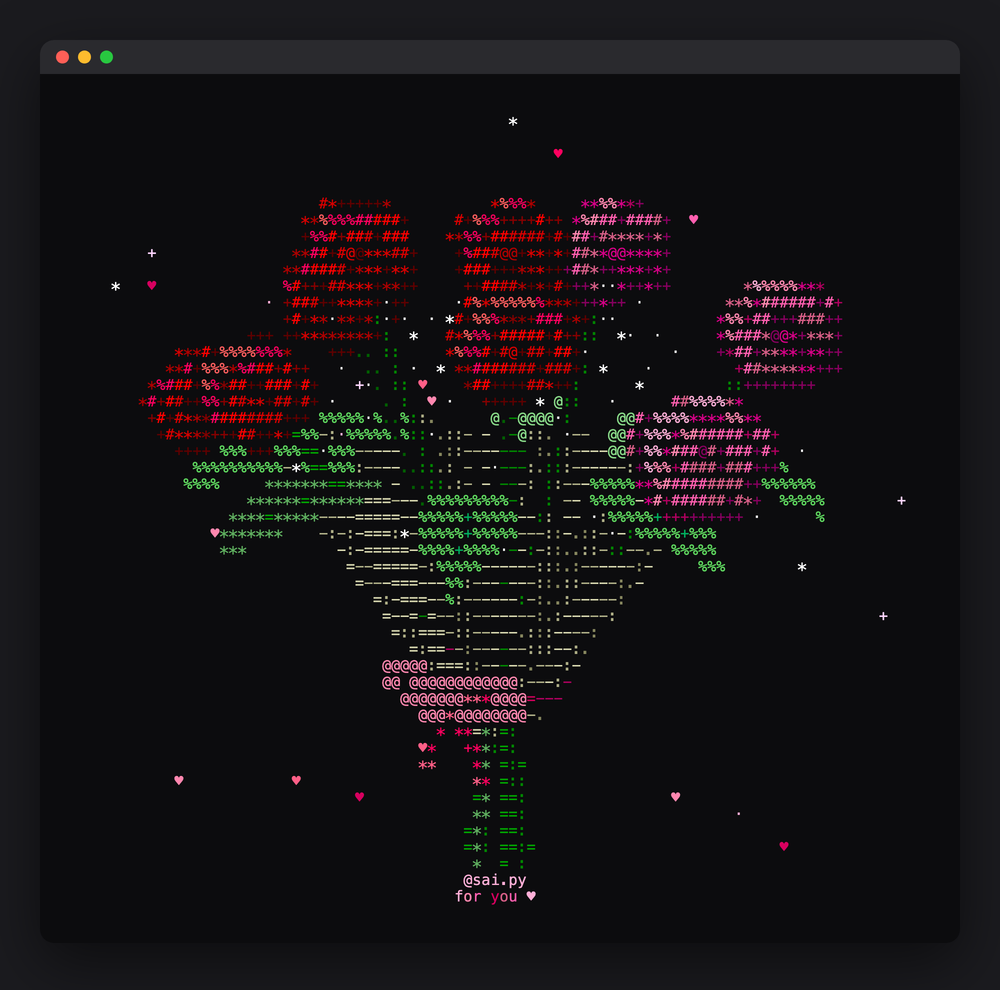

# Flowers for Her 🌹

A spinning 3D bouquet of roses that runs right in your terminal, wrapped in paper with a ribbon, baby's breath, sparkles and floating hearts. It's all drawn with text characters.

<p align="center">
  
</p>

## See it in your browser

Open **https://saikamara59.github.io/flowers-for-her/**. It works on phones too.

To change the message, add `?msg=` to the link, for example `https://saikamara59.github.io/flowers-for-her/?msg=Happy+birthday+♥`.

## Run it in your terminal

You just need Python 3. There are no packages to install.

```bash
git clone https://github.com/saikamara59/flowers-for-her.git
cd flowers-for-her
python3 bouquet3d.py
```

On Windows, use `python bouquet3d.py` instead.

Press `Ctrl+C` to stop it.

## Tips

- Make your terminal window big, or zoom out a bit (`Ctrl -` / `Cmd -`). More space makes the bouquet look smoother.
- Use a terminal that supports 256 colors. Most do: macOS Terminal, iTerm2, Windows Terminal, VS Code, and nearly everything on Linux.
- If the hearts show up as boxes, switch your terminal font to one with good Unicode support.

## Make it yours

Open `bouquet3d.py` and change the values at the top:

| Setting | What it does |
| --- | --- |
| `MESSAGE` | The text under the bouquet. Put her name here. |
| `FLOWERS` | `"roses"` for a rose bouquet, or `"mixed"` for daisies and tulips |
| `SPIN_SPEED` | How fast it spins |
| `TILT` | How much you look down at it |
| `CAM_DIST` | A lower number gives a more dramatic perspective |
| `NUM_HEARTS` | How many hearts float in the background |
| `FPS` | Frame rate |

To change the rose colors, edit `ROSE_RED`, `ROSE_PINK` and the `ROSE_COLORS` list. They're 256-color terminal codes.

## How it works

Every part of the bouquet is a set of 3D points. Each frame, the points are rotated, projected onto the screen with perspective, and shaded based on a light direction. A depth buffer makes sure the closest thing wins each character spot. The flower heads are flat shapes that always face you, so they stay readable while it spins. Each rose is a spiral of petals wrapping in toward its center.

## Credits

Based on [Ascii Flower Bouquet](https://github.com/alishsharma17/Ascii-Flower-Bouquet-) by Alish Sharma, under the MIT License. The roses and the `@sai.py` signature were added here.
